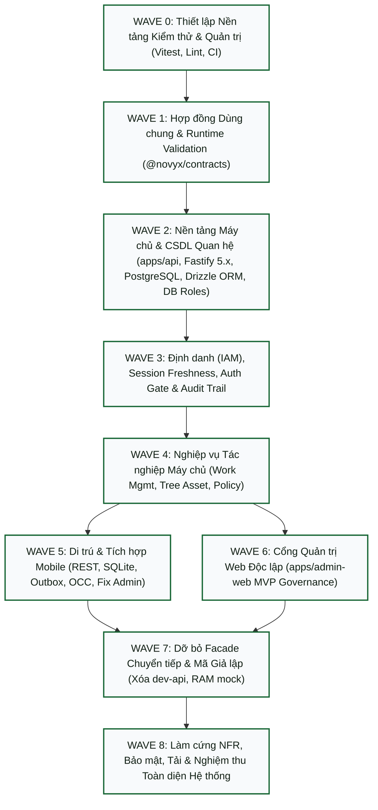

# Kế Hoạch Triển Khai Kỹ Thuật Tổng Thể (Phase 12 Implementation Master Plan)

**Dự án:** NOVYX GreenOps
**Giai đoạn:** Phase 12B — Owner Implementation Decision Review (Batch 3 Reconciled)
**Trạng thái Kế hoạch:** ĐANG ĐỐI SOÁT QUYẾT ĐỊNH CHỦ QUẢN (OWNER IMPLEMENTATION DECISION REVIEW IN PROGRESS — BATCH 3 RECONCILED)
**Ngày lập:** 21/09/2026
**Commit Baseline (Phase 12A Frozen):** `9df1b290dd2853afcb9fdcaacb299d02c28c1f8a`

> ⚠️ **NGUYÊN TẮC CỐT TỬ (CORE RULE):**
> **PHASE 12 LÀ GIAI ĐOẠN LẬP KẾ HOẠCH & ĐỐI SOÁT QUYẾT ĐỊNH THUẦN TÚY (PLANNING & DECISION REVIEW ONLY).**
> **TUYỆT ĐỐI KHÔNG TRIỂN KHAI MÃ NGUỒN CỦA KIẾN TRÚC MỤC TIÊU.**
> Không tạo `apps/api`, không tạo `apps/admin-web`, không cài đặt thư viện (`zod`, `expo-sqlite`, `fastify`, `drizzle-orm`, argon2, auth), không tạo file migration CSDL, không sửa đổi mã nguồn di động hay hợp đồng tại pha này.

---

## 1. Mục Đích Kế Hoạch (Purpose)

Kế hoạch này thiết lập lộ trình kỹ thuật hữu hạn, có thứ tự phụ thuộc chặt chẽ, dựa trên bằng chứng thực nghiệm của mã nguồn hiện trạng nhằm chuyển đổi hệ thống từ mô hình **Fat Client Monolith** sang **Kiến trúc Mục tiêu Đã được Phê duyệt** (ADR 0001..0013) mà không gây gián đoạn hoạt động của ứng dụng di động hiện hữu.

---

## 2. Đường Cơ Sở Đầu Vào Đã Đóng Băng (Frozen Input Baseline)

1. **Cam kết Git Entry Gate:** Commit `873533248ca62d7eb08b84f2245ce1f4dec74150` (Working tree clean).
2. **Đường cơ sở Nghiệp vụ (Business Baseline):** Đã đóng băng 100% tại Phase 1–7 ([`PRODUCT.md`](PRODUCT.md), [`DOMAIN.md`](DOMAIN.md), [`ACCESS-CONTROL.md`](ACCESS-CONTROL.md), [`WORKFLOWS.md`](WORKFLOWS.md), [`REQUIREMENTS-TRACEABILITY.md`](REQUIREMENTS-TRACEABILITY.md)). Tuyệt đối không thay đổi vai trò, quyền hạn, máy trạng thái hay quy trình tác nghiệp.
3. **Đường cơ sở Kiến trúc (Technical Baseline):** Toàn bộ 13 ADR (`ADR 0001`..`0013`) đã ở trạng thái `ACCEPTED` và đóng băng tại Phase 11B.
4. **Văn bản & Biểu đồ Hợp nhất:** [`docs/ARCHITECTURE.md`](ARCHITECTURE.md) và các biểu đồ dẫn xuất ([`docs/diagrams/10-system-target-architecture.html`](diagrams/10-system-target-architecture.html), [`docs/diagrams/12-architecture-dependency-map.html`](diagrams/12-architecture-dependency-map.html), [`docs/diagrams/08-role-information-architecture.html`](diagrams/08-role-information-architecture.html)) đã đối soát đồng bộ tại Phase 11C.

---

## 3. Thứ Tự Ưu Tiên Giải Thích Triển Khai (Implementation Precedence)

Khi đọc và diễn giải các tài liệu kỹ thuật để lập kế hoạch triển khai, áp dụng trật tự ưu tiên pháp lý nghiêm ngặt sau:

```text
[1] Phạm vi Chấp thuận Chính thức (Acceptance Scope trong từng ADR)
     ↓
[2] Sổ bộ Quyết định Cuối cùng của Chủ quản (Owner Decision Ledger / Batch 1, 2 & 3)
     ↓
[3] Các điều khoản quyết định đã được duyệt nhất quán với [1] & [2]
     ↓
[4] Văn bản Kiến trúc Hợp nhất Chuẩn tắc (docs/ARCHITECTURE.md)
     ↓
[5] Văn bản lịch sử tiền chấp thuận (Options Considered, Proposed Decision cũ, Candidate Examples)
```

> **GHI CHÚ DIỄN GIẢI TRIỂN KHAI QUAN TRỌNG (`IMPLEMENTATION_INTERPRETATION_NOTE` — ADR 0009):**
> Trong tệp [`docs/adr/0009-concurrency-idempotency-strategy.md`](adr/0009-concurrency-idempotency-strategy.md), tại dòng 66, 79, 141 có chứa các đoạn văn lịch sử đề xuất sao chép `idempotencyKey` vào body của DTO, và dòng 119 ghi nhận `TaskStatus remains IN_PROGRESS` khi gặp lỗi 409 Conflict.
> **Nguyên tắc triển khai chuẩn tắc:** Các câu văn trên là **VĂN BẢN LỊCH SỬ KHÔNG CÓ GIÁ TRỊ RÀNG BUỘC (NON-BINDING HISTORICAL PROSE)**, đã bị thay thế hoàn toàn bởi **Acceptance Scope** của Owner và `ARCHITECTURE.md` (§3.6, §3.7, §3.8):
> 1. `Idempotency-Key` là **HTTP Transport Header**, lưu trong metadata của hàng đợi Outbox trên di động, **tuyệt đối không đưa vào body của Business DTO**.
> 2. Khi máy chủ trả về lỗi `409 CONFLICT` (xung đột phiên bản), **bằng chứng hiện trường cục bộ được bảo toàn an toàn trên máy**, nhưng **trạng thái tác vụ của máy chủ (`TaskStatus`) là thẩm quyền tối cao và client phải hòa giải theo máy chủ**.
> 3. Tuyệt đối không sửa tệp ADR 0009 (bảo toàn tính lịch sử bất biến).

---

## 4. Thực Trạng Kho Mã Nguồn Thực Tế (Current Repository State)

Theo báo cáo chứng cứ pháp y [`docs/PHASE12-CURRENT-SOURCE-EVIDENCE.md`](PHASE12-CURRENT-SOURCE-EVIDENCE.md):
- **Cấu trúc Không gian làm việc:** Monorepo npm workspaces gồm `@novyx/mobile`, `@novyx/contracts`, `@novyx/config`, `@novyx/ui`.
- **Thành phần còn thiếu:** Chưa có `apps/api` (backend máy chủ) và chưa có `apps/admin-web` (cổng quản trị web).
- **Hợp đồng hiện hữu:** `@novyx/contracts` thiếu 2 trạng thái `BLOCKED` / `CANCELLED`, thiếu `ProofProfile`, thiếu 2 kết luận duyệt chuẩn tắc (`APPROVE_WITH_EXCEPTION`, `CANCEL`) và chưa chuẩn hóa SCREAMING_SNAKE_CASE, thiếu trường `version` / `expectedVersion`, và chưa có Zod schema runtime validation.
- **Dịch vụ di động:** `greenOpsService.ts` là một đơn khối 856 dòng ôm đồm 10 trách nhiệm (RAM snapshot volatile, fetch, login, projection, multipart, v.v.).
- **Giao diện di động:** `MobileApp.tsx` (2.054 dòng) ép cứng tài khoản Admin thành Manager và điều hướng qua cờ nhị phân `isStaff`. Logic quy trình 5 bước cũ bị mã hóa cứng trong UI (`mobileWorkflow.ts`).
- **Hạ tầng kiểm thử:** Chưa có test runner tự động (Jest/Vitest) cho mã nguồn sản phẩm; chưa có CI workflows.

---

## 5. Sổ Bộ Khoảng Cách Triển Khai Đã Xác Nhận (Confirmed Implementation Gap Register)

Toàn bộ 15 khoảng cách kỹ thuật đã được kiểm chứng thực tế và đánh mã định danh chuẩn tắc:

| Mã Khoảng Cách | Chứng Cứ Mã Nguồn Thực Tế | Yêu Cầu Đóng Băng | ADR Thẩm Quyền | Kịch Bản NFR | Thành Phần Ảnh Hưởng | Mức Độ Rủi Ro | Đợt Triển Khai (`Wave`) | Phương Pháp Kiểm Chứng |
| :---: | :--- | :---: | :---: | :---: | :---: | :---: | :---: | :---: | :--- |
| **IMP-GAP-001** | `MobileApp.tsx:398`, `LoginScreen.tsx:41,117` | `CAP-ADM-01..09` | ADR 0005 | `QAS-SEC-01` | `apps/mobile` | **CRITICAL** | **Wave 5** | Kiểm thử đăng nhập Admin trên mobile bị từ chối chuyển hướng tác vụ hiện trường |
| **IMP-GAP-002** | `MobileApp.tsx:274, 276` (`isStaff = role === 'Staff'`) | `AC-01..04` | ADR 0007 | `QAS-SEC-01` | `apps/mobile` | **HIGH** | **Wave 5** | Phân quyền 3 vai trò độc lập, không dùng cờ nhị phân |
| **IMP-GAP-003** | `packages/contracts/src/index.ts:54-62` (Thiếu BLOCKED/CANCELLED)| `DR-MVP-03`, `WF-01` | ADR 0003, 0010 | `QAS-FAULT-01`| `packages/contracts` | **CRITICAL** | **Wave 1** | TypeScript compilation & Zod parsing test đúng 7 trạng thái |
| **IMP-GAP-004** | `packages/contracts/src/index.ts:71` (Thiếu ProofProfile & 4 Reviews)| `DR-MVP-02`, `DR-MVP-06` | ADR 0010 | `QAS-OFFLINE-01`| `packages/contracts` | **HIGH** | **Wave 1** | Schema validation kiểm tra 3 profiles và 4 kết luận duyệt chuẩn tắc: `APPROVE`, `APPROVE_WITH_EXCEPTION`, `REQUEST_REWORK`, `CANCEL` |
| **IMP-GAP-005** | `scripts/greenops-dev-api.cjs:407-430`, `greenOpsService.ts:418` | `AC-01..04`, `DR-HARD-02` | ADR 0007, 0012 | `QAS-SEC-01` | `apps/api` | **CRITICAL** | **Wave 3, Wave 4**| Integration test từ chối tạo task nếu caller không phải Manager |
| **IMP-GAP-006** | `scripts/greenops-dev-api.cjs:397-404` (Task list bảo vệ ở UI) | `AC-01..04` | ADR 0007 | `QAS-SEC-01` | `apps/api` | **HIGH** | **Wave 3, Wave 4**| Security test: Staff chỉ nhận danh sách task gán cho chính mình |
| **IMP-GAP-007** | `greenOpsService.ts:354`, `greenops-dev-api.cjs:234` (RAM snapshot) | `NFR-OFFLINE` | ADR 0008, 0013 | `QAS-OFFLINE-01, 02` | `apps/mobile`, `apps/api` | **CRITICAL** | **Wave 2, Wave 5**| Kill app & restart máy: dữ liệu tồn lưu nguyên vẹn từ SQLite |
| **IMP-GAP-008** | Toàn bộ `apps/mobile/src/` (0 kết quả outbox) | `CAP-01, CAP-02` | ADR 0008 | `QAS-OFFLINE-01`| `apps/mobile` | **CRITICAL** | **Wave 5** | Airplane mode test: đóng gói outbox và retry tự động thành công |
| **IMP-GAP-009** | Cấu trúc thư mục root (Chưa có `apps/api`) | Kiến trúc Mục tiêu | ADR 0013 | Toàn bộ NFR | `apps/api` | **BLOCKER** | **Wave 2, 3, 4** | Khởi tạo thành công service Node.js Modular Monolith theo HTTP framework Fastify 5.x được Chủ quản phê duyệt (IDB-02) |
| **IMP-GAP-010** | Cấu trúc thư mục root (Chưa có `apps/admin-web`) | `CAP-ADM-01..09` | ADR 0005 | `QAS-A11Y-01` | `apps/admin-web` | **HIGH** | **Wave 6** | E2E test các chức năng quản trị trên giao diện Web chuyên biệt |
| **IMP-GAP-011** | Toàn bộ repo (Chưa có bảng AuditEvent & DB privilege) | `CAP-ADM-05` | ADR 0011 | `QAS-SEC-01` | `apps/api` | **HIGH** | **Wave 2, Wave 3**| Chạy lệnh SQL UPDATE/DELETE/TRUNCATE trên bảng Audit bị PostgreSQL từ chối |
| **IMP-GAP-012** | `contracts/src/index.ts` (Thiếu version / expectedVersion) | `WF-01..08`, `QAS-FAULT-01` | ADR 0009 | `QAS-FAULT-01` | `contracts`, `api`, `mobile` | **HIGH** | **Wave 1, 4, 5** | Concurrency test: Gửi expectedVersion cũ nhận mã lỗi 409 CONFLICT |
| **IMP-GAP-013** | `greenOpsService.ts`, `contracts` (Thiếu Idempotency-Key) | Toàn vẹn Outbox | ADR 0009 | `QAS-OFFLINE-01`| `contracts`, `api`, `mobile` | **HIGH** | **Wave 1, 2, 5** | Retry test: Gửi cùng Idempotency-Key nhận response cached, không trùng task |
| **IMP-GAP-014** | `greenOpsService.ts:1-856` (Service ôm đồm 10 trách nhiệm) | Clean Architecture | ADR 0012 | `QAS-FAULT-01` | `apps/mobile` | **MEDIUM** | **Wave 5, Wave 7**| Phân rã thành Ports, Use Cases, Adapters độc lập theo Wave |
| **IMP-GAP-015** | `mobileWorkflow.ts:146-153`, `StaffProofFlow.tsx` (Logic ở UI) | Domain Engine | ADR 0012 | `QAS-A11Y-01` | `apps/mobile` | **MEDIUM** | **Wave 5** | Giao diện chỉ hiển thị (Advisory), gọi State Machine điều phối |

---

## 6. Sổ Bộ Quyết Định Cấp Triển Khai (Implementation Decision Register Summary)

Chi tiết đầy đủ 11 quyết định được quản lý tại [`docs/PHASE12-IMPLEMENTATION-DECISION-REGISTER.md`](PHASE12-IMPLEMENTATION-DECISION-REGISTER.md) và biên bản phê duyệt tại [`docs/PHASE12-OWNER-IMPLEMENTATION-DECISIONS.md`](PHASE12-OWNER-IMPLEMENTATION-DECISIONS.md).
**Hiện tại: 8 quyết định đã được Chủ quản phê duyệt (`OWNER_APPROVED`), 3 quyết định tiếp tục giữ trạng thái `OPEN` (an toàn để hoãn):**
- **IDB-01 (CSDL Quan hệ):** **PostgreSQL** (Baseline khởi đầu: 18.x; Môi trường sản xuất: Supported Stable Major + Minor) — `OWNER_APPROVED`.
- **IDB-02 (Web Framework):** **Fastify 5.x** (Node.js runtime, Zod/@novyx/contracts là Contract Authority) — `OWNER_APPROVED`.
- **IDB-03 (ORM / Query Builder):** **Drizzle ORM + drizzle-kit** (Kèm Raw SQL escape hatch cho DB privileges/indexes) — `OWNER_APPROVED`.
- **IDB-04 (Cấu trúc Token Xác thực):** **Opaque Bearer Access Credential + Rotating Opaque Refresh Credential** (Lưu bản băm máy chủ, CSPRNG, kiểm tra tính tươi tài khoản, phát hiện tái sử dụng, TTL không đóng băng cố định) — `OWNER_APPROVED`.
- **IDB-05 (Băm Mật khẩu):** **Argon2id** (Muối ngẫu nhiên duy nhất, benchmark tham số sản xuất trên phần cứng đích, hỗ trợ rehash khi đổi chính sách) — `OWNER_APPROVED`.
- **IDB-06 (Nền tảng Admin Web):** **React 19 SPA + Vite** (Workspace `apps/admin-web`, TypeScript, quyền Platform Admin `CAP-ADM-01..09` và read-only `OP-22`, không có quyền task hiện trường, SPA không phải ranh giới an ninh, Render Static Site là ưu tiên demo không khóa cứng kiến trúc) — `OWNER_APPROVED`.
- **IDB-07 (Lưu trữ Bằng chứng Ảnh):** **S3-Compatible Object Storage Port** (Định nghĩa `IObjectStoragePort`, Infrastructure Adapter tương thích S3, Cloudflare R2 Free Tier là ưu tiên demo số 1, MinIO dev, tính trung lập nhà cung cấp, upload thành công $\ne$ nghiệm thu nghiệp vụ) — `OWNER_APPROVED`.
- **IDB-08 (Chiến lược Đóng gói & Hosting):** Khuyến nghị **Docker Compose trên Linux VM cho MVP** (`OPEN` — Hoãn Wave 8; định hướng demo chi phí $0 là hướng dẫn phi ràng buộc, không giải quyết IDB-08).
- **IDB-09 (Thời gian Lưu Idempotency):** Khuyến nghị **Biến môi trường** (giá trị cơ sở ứng viên: 72h, bất biến: thời gian lưu $\ge$ chu kỳ retry ngoại tuyến tối đa, phân loại: `CANDIDATE_BASELINE` / `NEEDS_FIELD_MEASUREMENT`, `OPEN` — Hoãn Wave 5).
- **IDB-10 (Dọn Dẹp Ảnh Mobile GC):** Khuyến nghị **Giữ ảnh sau COMPLETED ACK** (giá trị cơ sở ứng viên: 14 ngày, ngưỡng dọn dẹp cơ sở: 300 MB, ngưỡng outbox cảnh báo cơ sở: 100 tác vụ, phân loại: `CANDIDATE_BASELINE` / `NEEDS_FIELD_MEASUREMENT`, `OPEN` — Hoãn Wave 5).
- **IDB-11 (Quản Lý Phiên Máy Chủ):** **PostgreSQL-backed Session Repository cho MVP** (Lưu phiên trong CSDL qua Clean Architecture Port, không đòi hỏi Redis, thu hồi nguyên tử) — `OWNER_APPROVED`.

---

## 7. Đồ Thị Phụ Thuộc Các Đợt Triển Khai (Dependency Graph)

Mô hình triển khai được tổ chức thành đồ thị có hướng không chu trình (DAG) gồm 9 đợt (Wave 0 đến Wave 8):



---

## 8. Chiến Lược Chuyển Đổi Không Gián Đoạn (Migration Strategy — Single Authoritative Business Truth)

Tuyệt đối cấm viết lại toàn bộ cùng một lúc (Big-Bang Rewrite). Quá trình di trú tuân thủ mô hình Strangler Fig Pattern qua 4 giai đoạn tiến hóa, bảo đảm **DUY NHẤT MỘT NGUỒN CHÂN LÝ NGHIỆP VỤ (Single Authoritative Business Truth)** trên mỗi môi trường:

```text
[Giai đoạn 1: Hiện trạng AS-IS]
  Mobile App ──(Gọi trực tiếp)──> greenOpsService (Mock RAM / greenops-dev-api.cjs)

[Giai đoạn 2: Song song Chuyển tiếp (Transitional Coexistence - Wave 2..4)]
  Xây dựng apps/api hoàn chỉnh độc lập. Mobile App tiếp tục chạy với mock/dev-api trong môi trường dev/test.

[Giai đoạn 3: Bật Chuyển đổi Từng phần (Strangler Cutover - Wave 5)]
  Mobile App ──(Cờ EXPO_PUBLIC_DATA_SOURCE=rest)──> apps/api (Authoritative Monolith)
             └──(Khi mất mạng / lỗi kết nối)──────> SQLite Local Draft & Outbox Intent
             *(TUYỆT ĐỐI CẤM fallback thực thi nghiệp vụ sang Mock RAM / Legacy Engine)*

[Giai đoạn 4: Thu hồi Mã Lạc hậu (Legacy Retirement - Wave 7)]
  Xóa bỏ hoàn toàn mã giả lập RAM và scripts/greenops-dev-api.cjs sau khi hoàn tất nghiệm thu.
```

### Nguyên tắc Bất biến về Thẩm quyền Nghiệp vụ (No Dual Business Truth):
1. **Trước Cắt Chuyển (Pre-cutover):** Chế độ giả lập (`mock`) hoặc máy chủ dev cũ (`greenops-dev-api.cjs`) chỉ phục vụ mục đích phát triển cục bộ, kiểm thử tự động và đảm bảo tương thích ngược trong các đợt chưa cắt chuyển.
2. **Sau Cắt Chuyển (Post-cutover):** Một khi môi trường (staging/production) đã cấu hình nhận lệnh ghi vào `apps/api`, máy chủ là **thẩm quyền tối cao và duy nhất xác thực và ghi nhận đột biến nghiệp vụ**.
3. **Cấm Tự Động Rớt Lại (No Automatic Mutation Failover):** Khi gặp sự cố mạng hoặc lỗi API REST (5xx, Timeout, Connection Refused), ứng dụng di động **TUYỆT ĐỐI KHÔNG TỰ ĐỘNG CHUYỂN HOẶC RƠI VỀ (FALLBACK) để thực thi cùng chuyển dịch nghiệp vụ đó trên Mock RAM, local business engine, hoặc dev API cũ như một thẩm quyền thay thế**.
4. **Hành vi Ngoại tuyến Chuẩn tắc:**
   - Bảo tồn bản nháp (Draft) và ảnh bằng chứng an toàn trong Sandbox của thiết bị.
   - Đóng gói ý đồ nộp vào Hàng đợi Outbox bền vững trên SQLite kèm `Idempotency-Key` cố định.
   - Thử lại gửi lên máy chủ khi có kết nối mạng trở lại.
   - SQLite chỉ lưu đệm (cache), lưu nháp (draft), hàng đợi (outbox) và metadata đồng bộ; **không tự ý quyết định chuyển dịch trạng thái tác vụ chính thức**.
5. **Kỷ luật Cờ Dữ liệu (`EXPO_PUBLIC_DATA_SOURCE`):** Cờ này chỉ được sử dụng ở cấp độ cấu hình môi trường (Build-time / Environment Configuration) phục vụ phát triển/kiểm thử hoặc quyết định rollback toàn môi trường có kế hoạch trước cutover. Cờ này **tuyệt đối không được sử dụng làm cơ chế failover tự động theo từng request (per-request runtime failover) giữa hai thẩm quyền nghiệp vụ khác nhau**. Mọi kịch bản rollback sau khi đã phát sinh dữ liệu ghi chính thức bắt buộc phải có quy trình đối soát dữ liệu rõ ràng.

---

## 9. Wave 0: Thiết Lập Nền Tảng Kiểm Thử & Quy Chuẩn (Wave 0)

- **Mục tiêu:** Xây dựng khung kiểm thử tự động tập trung và bộ quy chuẩn kiểm soát mã nguồn trước khi bắt đầu viết mã mục tiêu.
- **Phạm vi & Tệp tin:**
  - Cấu hình Vitest cho toàn monorepo (`vitest.config.ts` ở root và packages).
  - Bổ sung script `test` vào `package.json` gốc: `"test": "vitest run"`.
  - Cấu hình GitHub Actions CI cơ bản (`.github/workflows/ci.yml`) chạy: `format:check`, `lint`, `typecheck`, `test`.
- **Phụ thuộc:** Zero (chạy ngay trên baseline hiện tại).
- **Tiêu chuẩn Nghiệm thu (Exit Gate):** Lệnh `npm test` chạy thành công, phát hiện đúng các bài kiểm thử cơ sở; CI script vượt qua kiểm tra tĩnh.

---

## 10. Wave 1: Hợp Đồng Dùng Chung & Runtime Validation (Wave 1)

- **Mục tiêu:** Cập nhật `@novyx/contracts` thành chuẩn Contract-First hoàn chỉnh với Zod runtime validation, làm căn cứ cho cả backend và client.
- **Phạm vi & Tệp tin:**
  - [`packages/contracts/src/index.ts`](packages/contracts/src/index.ts), bổ sung các tệp schema module hóa.
  - Cài đặt `zod` vào `packages/contracts`.
  - Bổ sung enum chuẩn tắc: `TaskStatus` (7 trạng thái SCREAMING_SNAKE_CASE: `PENDING`, `IN_PROGRESS`, `BLOCKED`, `WAITING_REVIEW`, `REWORK_REQUIRED`, `COMPLETED`, `CANCELLED`).
  - Bổ sung `ProofProfile` (`CHANGE_PROOF`, `SERVICE_PROOF`, `INSPECTION_PROOF`) và 4 `ReviewDecision` chuẩn tắc: `APPROVE`, `APPROVE_WITH_EXCEPTION`, `REQUEST_REWORK`, `CANCEL`.
  - Bổ sung `AccountStatus` (`INVITED`, `ACTIVE`, `SUSPENDED`, `DISABLED`).
  - Bổ sung `version: number` vào entity DTOs và `expectedVersion: number` vào mutation payloads đối với entity đã có phiên bản.
  - Định nghĩa Header schema: `Idempotency-Key` (UUIDv4).
  - Xuất các kiểu TypeScript suy diễn tự động qua `z.infer<typeof Schema>`.
- **Ràng buộc:** Cấm phụ thuộc vào mã nguồn ứng dụng (`apps/*`). Không xóa ngay các type cũ mà dùng alias chuyển tiếp nếu mobile hiện tại cần tương thích.
- **Tiêu chuẩn Nghiệm thu (Exit Gate):** Bộ kiểm thử hợp đồng `contracts.spec.ts` xác thực pass 100% các schemas; `npm run typecheck` đạt trạng thái sạch.

---

## 11. Wave 2: Nền Tảng Máy Chủ & CSDL Quan Hệ (Wave 2)

- **Mục tiêu:** Khởi tạo workspace `apps/api`, thiết lập kết nối CSDL quan hệ PostgreSQL (IDB-01 OWNER_APPROVED), công cụ persistence Drizzle ORM + drizzle-kit (IDB-03 OWNER_APPROVED), HTTP web framework Fastify 5.x (IDB-02 OWNER_APPROVED) và cơ chế phân tách đặc quyền DB.
- **Phạm vi & Tệp tin:**
  - Khởi tạo thư mục `apps/api/` với cấu trúc Clean Architecture: `src/core/` (Use Cases, Ports), `src/infrastructure/` (Fastify routing, Drizzle repositories, PostgreSQL adapters), `src/modules/`.
  - Cấu hình file di trú CSDL qua `drizzle-kit` kết hợp các script migration SQL chuyên biệt khi cần.
  - Khởi tạo migration DDL tạo bảng người dùng, bảng phiên, bảng kiểm toán `audit_events`.
  - Thiết lập script SQL phân tách đặc quyền người dùng runtime DB PostgreSQL: Cấp quyền `INSERT, SELECT` trên `audit_events`, thu hồi `UPDATE, DELETE, TRUNCATE` đối với runtime application DB role.
  - Mốc triển khai ban đầu: PostgreSQL 18.x; môi trường vận hành sản xuất yêu cầu một bản major ổn định được hỗ trợ và bản minor hiện hành.
- **Ràng buộc Kiến trúc & Ranh giới:**
  - **Bảo toàn Clean Architecture:** HTTP/Fastify và Drizzle/PostgreSQL là các chi tiết hạ tầng (Infrastructure) triển khai các Ports. Tầng Domain Core và Application Use Cases tuyệt đối KHÔNG phụ thuộc vào Drizzle (`Domain -> Drizzle` bị cấm) và KHÔNG phụ thuộc vào Fastify (`Domain -> Fastify` và `Application -> Fastify request objects` bị cấm).
  - **Thẩm quyền Hợp đồng:** `@novyx/contracts` và Zod schemas là thẩm quyền hợp đồng duy nhất tại runtime boundary; Fastify JSON Schema không thay thế Zod.
  - **Chính sách Di trú An toàn Dữ liệu:** Mọi migration đều bắt buộc phải có Chiến lược Khôi phục / Phục hồi (Rollback / Recovery Strategy) được lập tài liệu rõ ràng; không ép buộc `down.sql` hình thức nếu có nguy cơ phá hủy dữ liệu.
  - Cấm import `packages/ui`. Bounded Contexts là module logic nội bộ của `apps/api`, không tách thành npm packages riêng.
- **Tiêu chuẩn Nghiệm thu (Exit Gate):** Chạy migration CSDL thành công; script kiểm thử quyền DB xác nhận runtime user bị từ chối khi thực hiện `UPDATE`, `DELETE`, `TRUNCATE` trên bảng `audit_events`; máy chủ Fastify 5.x khởi động và phản hồi health check sạch sẽ.

---

## 12. Wave 3: IAM, Session Freshness, Auth Gate & Audit Trail (Wave 3)

- **Mục tiêu:** Hiện thực hóa module IAM, hạ tầng quản lý phiên trên PostgreSQL (IDB-11 OWNER_APPROVED), cơ chế xác thực Opaque Credentials (IDB-04 OWNER_APPROVED), băm mật khẩu Argon2id (IDB-05 OWNER_APPROVED), middleware bảo vệ an ninh tầng máy chủ (Tier 2 Gate) và lưu trữ nhật ký kiểm toán trung tâm append-only.
- **Phạm vi & Nhiệm Vụ Triển Khai:**
  - `apps/api/src/modules/iam/`:
    - Quản lý người dùng và tài khoản bền vững (User/Account persistence).
    - Vòng đời băm mật khẩu Argon2id: muối ngẫu nhiên duy nhất cho từng mật khẩu, tham số chi phí sản xuất đo đạc thực nghiệm trên phần cứng máy chủ đích (`NEEDS_BENCHMARK`), hỗ trợ tự động băm lại khi đăng nhập thành công (`rehash-on-successful-login`).
    - Quy trình xác thực đăng nhập và khởi tạo phiên làm việc.
    - Cấp phát thông tin xác thực: sinh Opaque Bearer Access Credential và Rotating Opaque Refresh Credential bằng CSPRNG với đủ entropy mã hóa; máy chủ **TUYỆT ĐỐI KHÔNG lưu bản rõ (plaintext)** của access token mà chỉ lưu bản băm an toàn phục vụ tra cứu (`hash(token)`).
    - Cơ chế xoay vòng Refresh Credential khi làm mới phiên và cơ chế phát hiện tái sử dụng (reuse detection) để vô hiệu hóa phiên / họ token (token family) bị ảnh hưởng với bán kính ảnh hưởng xác định.
    - Cơ chế đăng xuất và thu hồi phiên giao dịch (transactional revocation).
  - `apps/api/src/infrastructure/security/`:
    - Middleware Tier 2 Security Gate: phân giải token hash, tra cứu phiên, kiểm tra tính tươi tài khoản tức thì (`AccountStatus == ACTIVE`) và kiểm tra `authVersion` / `sessionVersion` theo `WF-12`.
    - Phân quyền mức thô theo endpoint (coarse route authorization: identity, role, active status, session freshness).
  - `apps/api/src/infrastructure/persistence/`:
    - Cổng trừu tượng `SessionRepository Port` và adapter `PostgreSQLSessionRepository` triển khai qua Drizzle ORM. Không đòi hỏi Redis cho MVP.
  - `apps/api/src/modules/audit/`:
    - Dịch vụ ghi nhận `AuditEvent` append-only tức thời trong giao dịch cho các sự kiện quản trị định danh: `ProvisionUser`, `AssignRole`, `SuspendAccount`, `ActivateAccount`, `DisableAccount`, `UnlockAccount`, `ResetCredentialSetup`.
- **Luồng Xử Lý Thông Tin Xác Thực (Auth Credential Flow):**
  - **ĐĂNG NHẬP (LOGIN):** Xác minh mật khẩu Argon2id $\rightarrow$ Xác minh `AccountStatus == ACTIVE` $\rightarrow$ Khởi tạo phiên CSDL $\rightarrow$ Cấp Opaque Access Credential $\rightarrow$ Cấp Rotating Opaque Refresh Credential.
  - **REQUEST CÓ BẢO VỆ (PROTECTED REQUEST):** Phân giải Opaque Access Credential (qua token hash) $\rightarrow$ Tải trạng thái phiên / IAM hiện hành $\rightarrow$ Xác minh `AccountStatus == ACTIVE` $\rightarrow$ Xác minh `authVersion` / `sessionVersion` khớp $\rightarrow$ Phân quyền thô ở Tier 2 Gate $\rightarrow$ Kiểm tra điều kiện nghiệp vụ chi tiết tại Application/Domain.
  - **LÀM MỚI PHIÊN (REFRESH):** Xác thực Refresh Credential hiện hành $\rightarrow$ Xác minh tính tươi tài khoản & phiên $\rightarrow$ Xoay vòng credential (vô hiệu hóa refresh credential cũ, cấp credential thay thế mới).
- **Ràng Buộc Kiến Trúc & Ranh Giới:**
  - **Bảo toàn Clean Architecture:** Logic IAM và Use Cases chỉ phụ thuộc `SessionRepository Port`; `PostgreSQLSessionRepository` là adapter tại tầng Infrastructure. Tuyệt đối CẤM tầng Domain/Application phụ thuộc trực tiếp vào Drizzle hay PostgreSQL (`Domain -> Drizzle` và `Domain -> PostgreSQL` bị CẤM).
  - **Ranh giới Phân quyền Nghiệp vụ:** Middleware Fastify chỉ thực hiện xác thực định danh và phân quyền thô (coarse route authorization). Thẩm quyền nghiệp vụ chi tiết (Fine-grained business eligibility: Actor Role $\wedge$ Resource Scope $\wedge$ Domain State $\wedge$ Business Preconditions) nằm trọn vẹn trong tầng Application/Domain; tuyệt đối không chuyển toàn bộ thẩm quyền nghiệp vụ vào middleware Fastify.
  - **Bảo toàn Bất biến Nghiệp vụ:** Việc khóa tài khoản hoặc thay đổi role trong IAM **tuyệt đối KHÔNG trực tiếp làm đột biến `TaskStatus`** của các tác vụ hiện trường.
  - **Không Tạo Lệnh Nghiệp Vụ Tự Tạo:** Tuyệt đối không tạo lệnh nghiệp vụ mang tên `RevokeSession` (thu hồi phiên thuần túy là hệ quả kỹ thuật của đăng xuất hoặc đổi quyền).
  - **Không Khóa Cứng Hằng Số / Công Nghệ Chưa Duyệt:** Mốc TTL (15 phút, 30 ngày) và tham số Argon2id là chính sách cấu hình / đo đạc, không phải hằng số kiến trúc. Không khóa cứng thư viện `@node-rs/argon2` làm bất biến bắt buộc của Chủ quản. Không dùng JWT, JWKS trong luồng chính.
- **Tiêu chuẩn Nghiệm thu (Exit Gate):** Kiểm thử tự động chứng minh tài khoản bị suspend/disable bị chặn ngay lập tức ở request tiếp theo; refresh credential cũ bị từ chối và kích hoạt cảnh báo tái sử dụng; mật khẩu xác thực đúng qua Argon2id; hỗ trợ rehash khi cấu hình nâng cao; nhật ký kiểm toán ghi nhận đầy đủ mọi biến cố an ninh IAM.

---

## 13. Wave 4: Nghiệp Vụ Tác Nghiệp Máy Chủ (Wave 4)

- **Mục tiêu:** Hiện thực hóa 3 module tác nghiệp còn lại trong `apps/api`: Work Management (Core), Tree Asset Registry (Supporting), và Policy & Template Governance (Supporting); tích hợp cổng lưu trữ bằng chứng nhị phân theo kiến trúc S3-Compatible Object Storage Port đã được phê duyệt (IDB-07 OWNER_APPROVED).
- **Phạm vi & Tệp tin:**
  - `apps/api/src/modules/work-management/`: Task Aggregate, máy trạng thái 7 bước, xác thực bằng chứng (GPS/QR), workflow thẩm định 4 kết luận duyệt chuẩn tắc (`APPROVE`, `APPROVE_WITH_EXCEPTION`, `REQUEST_REWORK`, `CANCEL`), kiểm tra DR-HARD-02 (người nộp không được tự duyệt).
  - `apps/api/src/modules/tree-asset/`: Quản lý cây, QR code, CareHistory Projection (chỉ ghi nhận task `COMPLETED`).
  - `apps/api/src/modules/policy-governance/`: Cấu hình 3 ProofProfiles, mẫu Checklist.
  - `apps/api/src/infrastructure/storage/`:
    - Định nghĩa cổng trừu tượng `IObjectStoragePort` và adapter hạ tầng tương thích chuẩn S3 API (S3-compatible Infrastructure Adapter).
    - Tách rời toàn bộ tệp nhị phân bằng chứng ra khỏi PostgreSQL; thùng chứa (bucket/container) ở chế độ riêng tư theo mặc định (`private by default`).
    - Máy chủ kiểm soát việc sinh khóa đối tượng (`objectKey`), ủy quyền truy cập đối tượng qua URL có chữ ký tạm thời (`presigned URLs`) có thời hạn sống ngắn.
    - CSDL PostgreSQL chỉ lưu trữ định danh bằng chứng bền vững: `storageRef` / `objectKey`, `contentHash` / `checksum`, `contentType`, `size`, nguồn gốc/sở hữu bằng chứng (`evidence ownership/provenance`), timestamp và metadata nghiệp vụ; **tuyệt đối KHÔNG lưu URL có chữ ký tạm thời làm định danh bằng chứng bền vững**.
  - Tích hợp Middleware kiểm soát đồng thời (OCC): Bắt lỗi `expectedVersion` lệch và trả về `409 CONFLICT (STALE_VERSION)`.
  - Tích hợp Middleware Idempotency: Kiểm tra Header `Idempotency-Key`, lưu và phát lại response an toàn.
- **Ràng buộc Kiến trúc & Ranh giới Nghiệp vụ:**
  - **An Toàn Nghiệm Thu Tải Lên (Upload Acceptance Safety):** Phân định ranh giới tuyệt đối giữa *Tải tệp thành công lên Object Storage (Object Upload Success)* và *Nghiệm thu bằng chứng nghiệp vụ (Business Evidence Acceptance)*. Việc tệp nhị phân tải lên thành công vào bucket **tuyệt đối KHÔNG tự động**: chuyển đổi `TaskStatus`, đánh dấu bằng chứng hợp lệ, hoàn thành `SubmitEvidence`, hay cho phép chuyển trạng thái sang thẩm định. Máy chủ/tầng Ứng dụng bắt buộc phải kiểm tra quyền sở hữu tài nguyên, trạng thái tác vụ, yêu cầu minh chứng (`ProofProfile`), checksum/tính toàn vẹn và các tiền điều kiện nghiệp vụ trước khi ghi nhận bằng chứng.
  - **Tính Trung Lập Với Nhà Cung Cấp (Provider Neutrality):** Tầng Domain và Application tuyệt đối độc lập với Cloudflare R2, AWS S3, MinIO hay Railway. Tuyệt đối không lan truyền tên bucket R2, account ID, domain model riêng của Cloudflare hay R2 SDK types vào Domain Core hay `@novyx/contracts`. Ưu tiên bàn giao demo chi phí $0 sử dụng Cloudflare R2 Free Tier (hoặc Railway trial/MinIO dev) là chi tiết triển khai/cấu hình, không phải bất biến kiến trúc vĩnh cửu.
  - **Môi Trường Phát Triển Cục Bộ:** MinIO hoặc dịch vụ tương thích S3 khác được phép dùng cho dev/CI cục bộ, nhưng thuần túy là công cụ phát triển, không phải thẩm quyền kiến trúc production và không bắt buộc chạy MinIO trên production.
  - Cấm đột biến SQL chéo module. Giao tiếp liên module qua In-Process Module Interfaces.
- **Tiêu chuẩn Nghiệm thu (Exit Gate):** E2E test toàn bộ luồng tạo task -> nhận việc -> nộp bằng chứng -> duyệt nghiệm thu trên máy chủ đạt pass 100%.

---

## 14. Wave 5: Di Trú & Tích Hợp Ứng Dụng Di Động (Wave 5)

- **Mục tiêu:** Tái cấu trúc ứng dụng di động `apps/mobile`, tích hợp lưu trữ cục bộ bền vững (`expo-sqlite`), Hàng đợi Outbox, và kết nối với máy chủ `apps/api`.
- **Phạm vi & Tệp tin:**
  - Cài đặt và cấu hình `expo-sqlite` trong `apps/mobile`.
  - Xây dựng Hàng đợi Outbox (`DurableOutboxService`) trên SQLite: lưu trữ lệnh nộp bằng chứng kèm `Idempotency-Key` ổn định, tự động retry tuần tự (FIFO) khi có mạng.
  - Phân tách 3 chiều trạng thái: `TaskStatus` (thẩm quyền máy chủ), `LocalSubmissionStatus`, `SyncStatus`.
  - Xây dựng tầng REST Adapter chuẩn hóa, thay thế dần các nhánh trong `greenOpsService.ts`.
  - Xóa bỏ việc ép vai trò Admin thành Manager trong `MobileApp.tsx` và `LoginScreen.tsx`.
  - Cập nhật quy trình nộp bằng chứng linh hoạt theo 3 ProofProfiles, loại bỏ chuỗi 5 bước cứng nhắc cũ trong `mobileWorkflow.ts`.
  - Hiện thực hóa cơ chế hòa giải xung đột: Khi server trả về 409 Conflict, bằng chứng cục bộ vẫn được bảo toàn an toàn trên máy, nhưng `TaskStatus` cập nhật theo server.
- **Ràng buộc:** Giữ nguyên giao diện mượt mà, touch targets $\ge 48\text{px}$, không làm mất dữ liệu người dùng khi kill app hoặc mất mạng (QAS-OFFLINE-01, 02). Tuyệt đối không fallback thực thi nghiệp vụ sang mock engine khi lỗi kết nối.
- **Tiêu chuẩn Nghiệm thu (Exit Gate):** Kiểm thử ngắt mạng (Airplane mode) trên thiết bị Android: nộp bài ngoại tuyến, kill app, mở lại, bật mạng -> Outbox tự động đồng bộ thành công lên máy chủ.

---

## 15. Wave 6: Cổng Quản Trị Web Độc Lập (Wave 6)

- **Mục tiêu:** Khởi tạo và phát triển ứng dụng `apps/admin-web` dành riêng cho Platform Administrator theo ADR 0005, sử dụng kiến trúc React 19 SPA + Vite đã được phê duyệt (IDB-06 OWNER_APPROVED).
- **Phạm vi & Tệp tin:**
  - Khởi tạo workspace `apps/admin-web` bằng React 19, TypeScript và Vite. Mốc triển khai ban đầu tuân thủ bản phát hành React 19.x tương thích repository và bản phát hành Vite major được hỗ trợ; không đóng băng vĩnh viễn minor/patch.
  - Tiêu thụ trực tiếp `@novyx/contracts` và `@novyx/ui` (ở những thành phần thực sự tương thích môi trường web).
  - Hiện thực hóa 9 năng lực quản trị MVP (`CAP-ADM-01..09`):
    - `CAP-ADM-01`: Cấp phát người dùng mới (User Provisioning).
    - `CAP-ADM-02`: Gán vai trò (Role Assignment).
    - `CAP-ADM-03`: Vòng đời tài khoản (Account Lifecycle: Activate / Suspend / Disable).
    - `CAP-ADM-04`: Mở khóa & khôi phục tài khoản (Account Recovery / Unlock).
    - `CAP-ADM-05`: Thanh tra nhật ký kiểm toán bất biến (Audit Log Inspection).
    - `CAP-ADM-06`: Quản trị danh mục dữ liệu cây (Tree Master Data Governance).
    - `CAP-ADM-07`: Quản trị danh mục loại công việc (TaskType Catalog Governance).
    - `CAP-ADM-08`: Quản lý chính sách hồ sơ minh chứng (ProofProfile Policy Governance).
    - `CAP-ADM-09`: Quản lý mẫu danh mục kiểm tra (Checklist Template Governance).
  - Hiện thực hóa chức năng tra cứu lịch sử chăm sóc cây toàn hệ thống `OP-22 ViewCareHistory` ở chế độ chỉ đọc (Read-Only).
- **Ràng buộc Kiến trúc & Ranh giới An ninh:**
  - **Không Có Thẩm Quyền Tác Nghiệp Thông Thường:** Admin Web tuyệt đối KHÔNG có tính năng tạo task, gán việc, nhận việc, nộp bằng chứng, chuyển trạng thái task hay thẩm định nghiệm thu công việc hiện trường (`CreateTask`, `AssignTask`, `StartTask`, `SubmitEvidence`, `ApproveTask`, `RequestRework`) (bảo vệ PLAN-SOD-ADMIN / BR-ACT-01).
  - **SPA Không Phải Ranh Giới An Ninh (SPA is NOT a security boundary):** Khả năng hiển thị giao diện trên React/Vite (ẩn/hiện nút, route guards, điều kiện vai trò trong component) chỉ mang tính tư vấn/chỉ dẫn trải nghiệm (`ADVISORY`). Toàn bộ quyền truy cập và thực thi bắt buộc phải được thẩm định và thực thi uy quyền tại Máy chủ (Server Request Gate & Domain Authoritative Eligibility).
  - **Ranh Giới Lưu Trữ Credential Trình Duyệt (Browser Credential Boundary):** Việc lựa chọn Vite + React không tự động quyết định cơ chế lưu trữ credential trong trình duyệt. Tuyệt đối không tự ý chọn ngầm `localStorage`, `sessionStorage` hay `IndexedDB` cho refresh token làm kiến trúc an ninh cuối cùng; cơ chế xác thực Admin Web phải tuân thủ nghiêm ngặt ADR 0006, IDB-04, IDB-11 và giải quyết trong thiết kế an ninh/triển khai.
  - **Ưu Tiên Bàn Giao Chi Phí $0:** Render Static Site là phương án ưu tiên bàn giao cho môi trường demo hiện tại (do Admin Web là static SPA thuần túy). Tuy nhiên, Render **KHÔNG phải là kiến trúc bị khóa cứng bởi Chủ quản**; bất kỳ nền tảng lưu trữ tĩnh tương đương nào hỗ trợ định tuyến SPA, HTTPS và kết nối an toàn tới `apps/api` đều có thể được sử dụng thay thế.
- **Tiêu chuẩn Nghiệm thu (Exit Gate):** E2E test giao diện web Admin thực hiện đầy đủ các tác vụ quản trị tài khoản và xem audit log thành công qua máy chủ API.

---

## 16. Wave 7: Dỡ Bỏ Facade Chuyển Tiếp & Dọn Dẹp Mã Cũ (Wave 7)

- **Mục tiêu:** Loại bỏ toàn bộ mã nguồn tạm thời, mã giả lập RAM và script dev cũ sau khi hệ thống mới đã hoạt động ổn định.
- **Phạm vi & Tệp tin:**
  - Xóa bỏ file máy chủ giả lập cũ: [`scripts/greenops-dev-api.cjs`](scripts/greenops-dev-api.cjs).
  - Thu dọn các nhánh mock trong `greenOpsService.ts` hoặc thay thế hoàn toàn bằng các dịch vụ chuyên biệt (AuthService, TaskService, TreeService).
  - Xóa bỏ các types/schemas tạm thời không còn sử dụng.
- **Tiêu chuẩn Nghiệm thu (Exit Gate):** Toàn bộ hệ thống biên dịch sạch sẽ (`npm run check` pass), không còn bất kỳ dòng code nào tham chiếu tới mock RAM hay dev-api cũ.

---

## 17. Wave 8: Làm Cứng NFR, An Ninh & Nghiệm Thu Toàn Diện (Wave 8)

- **Mục tiêu:** Đảm bảo toàn bộ hệ thống thỏa mãn đầy đủ các chỉ số phi chức năng định lượng trong `docs/NFR.md` và sẵn sàng vận hành sản xuất.
- **Phạm vi:**
  - Profiling hiệu năng danh sách lớn (`QAS-PERF-01`): Đảm bảo tỷ lệ dropped frames $< 5\%$ trên thiết bị Android phổ thông.
  - Kiểm toán an ninh toàn diện: Kiểm tra thâm nhập (Pen-test) các ranh giới Tier 2 và Tier 3, kiểm tra rò rỉ dữ liệu qua API.
  - Kiểm toán độ tương phản và khả năng tiếp cận ngoài trời (`QAS-A11Y-01`): WCAG AA $\ge 4.5:1$, touch target $\ge 48\text{px}$.
  - Đóng gói hạ tầng sản xuất theo phương án được phê duyệt (IDB-08).
- **Tiêu chuẩn Nghiệm thu (Exit Gate):** Báo cáo nghiệm thu kỹ thuật xác nhận đạt 100% các tiêu chí SLO định lượng trong `docs/NFR.md`.

---

## 18. Chiến Lược Tiến Hóa Hợp Đồng Xuyên Suốt (Cross-Wave Contract Strategy)

1. **Nguyên tắc Contract-First:** Không một dòng mã máy chủ hay client nào được triển khai trước khi schema Zod và TypeScript DTO tương ứng được xuất bản tại `@novyx/contracts` (Wave 1).
2. **Phong Bì Chuẩn Hóa:** Mọi phản hồi API tuân thủ cấu trúc phong bì nghiêm ngặt:
   - Thành công: `ApiSuccess<TData> { data: TData }` hoặc `ApiList<TData> { data: TData[], meta: { nextCursor, hasMore } }`.
   - Thất bại: `ApiFailure { error: { code: ErrorCode, message: string, details?: Record<string, unknown>, requestId: string } }`.
3. **Phân Định Lớp Dữ Liệu:** Không nhầm lẫn giữa Lệnh Nghiệp vụ (`Business Command`), Tuyến đường HTTP (`Route`), DTO Payload và HTTP Headers.

---

## 19. Chiến Lược Di Trú Dữ Liệu & Khôi Phục (Data Migration Strategy)

1. **Di trú Dữ liệu Hạt giống (Seed Data Migration):**
   - Chuyển đổi dữ liệu cây và nhân viên mẫu từ `apps/mobile/src/data.ts` thành bộ migration seed dữ liệu chuẩn cho CSDL quan hệ trong Wave 2.
2. **Di trú Dữ liệu Client Cục bộ (Mobile Data Migration):**
   - Thiết lập SQLite schema versioning qua `PRAGMA user_version`.
   - Mọi thay đổi schema bảng SQLite phải có script nâng cấp tự động, bảo toàn 100% ảnh bằng chứng đã lưu trong Sandbox Filesystem trước đó.
3. **Chiến lược Khôi phục & An toàn Di trú (Rollback & Recovery Strategy):**
   - Thay vì áp đặt quy tắc cứng nhắc buộc mọi migration phải có file `down.sql` đối xứng (dễ tạo ra tính thuận nghịch giả tạo - fake reversibility - dẫn đến nguy cơ phá hủy hoặc làm hỏng dữ liệu khi revert), hệ thống xác lập bất biến: **Mọi đợt di trú dữ liệu hoặc thay đổi schema CSDL máy chủ bắt buộc phải có Chiến lược Khôi phục / Phục hồi (Rollback / Recovery Strategy) được lập thành tài liệu rõ ràng**, phân loại theo từng bản chất thay đổi:
     - **A. Di trú schema thuận nghịch (Reversible schema migration):** Áp dụng script down migration an toàn khi thay đổi thực sự có thể hoàn nguyên mà không làm mất mát dữ liệu (ví dụ: tạo bảng mới chưa dùng, thêm cột nullable mới, thêm index).
     - **B. Di trú schema/dữ liệu có tính phá hủy (Destructive schema/data migration):** Áp dụng chiến lược sao lưu/phục hồi (backup/restore) hoặc chiến lược sửa tiến (forward-fix strategy), tuyệt đối không rollback mù quáng.
     - **C. Di trú tương thích trực tuyến (Online compatibility migration):** Áp dụng mô hình mở rộng / thu hẹp (expand/contract migration), hỗ trợ cả phiên bản ứng dụng cũ và mới trong giai đoạn chuyển đổi.
     - **D. Chuyển đổi dữ liệu không thể đảo ngược (Irreversible data transformation):** Bắt buộc tạo điểm kiểm tra sao lưu (checkpoint/backup snapshot) độc lập và quy trình phục hồi chi tiết trước khi thực thi.
   - Kế hoạch Phase 12 ưu tiên tuyệt đối **bảo toàn dữ liệu (data preservation) và năng lực phục hồi (recoverability)** thay vì ép buộc migration đối xứng hình thức.
   - Ứng dụng di động duy trì cờ chuyển đổi nguồn dữ liệu (`EXPO_PUBLIC_DATA_SOURCE`) ở cấp môi trường build/chạy thử nghiệm. Cờ này không được dùng làm cơ chế failover tự động theo từng request sau khi đã chuyển sang ghi dữ liệu sản xuất.

---

## 20. Chiến Lược Kiểm Thử Đa Tầng (Test Strategy by Layer)

Hệ thống thiết lập 10 tầng kiểm thử tự động tương ứng với từng lớp kiến trúc:

| Tầng Kiểm Thử | Đối Tượng Kiểm Thử | Công Cụ Thực Thi | Trách Nhiệm Đảm Bảo |
| :--- | :--- | :---: | :--- |
| **1. Domain Tests** | Task Aggregate, Invariants, State Transitions | Vitest | Đảm bảo đúng 7 trạng thái, cấm chuyển sai quy tắc, bảo vệ DR-HARD-02 (Cấm tự nghiệm thu) |
| **2. Contract Tests** | Zod Schemas, Request/Response Envelopes | Vitest | Đảm bảo bắt lỗi dữ liệu sai ngay tại ranh giới, type-safety |
| **3. Auth & RBAC Tests** | Tier 2 Gate, Tier 3 Domain Eligibility | Supertest / Framework Inject | Kiểm tra ma trận quyền 4 chiều, cấm Admin can thiệp task |
| **4. IAM Freshness Tests**| Vòng đời phiên, kiểm tra AccountStatus, authVersion | Vitest + DB Testbed | Kiểm tra thu hồi phiên tức thì khi tài khoản bị khóa |
| **5. Concurrency (OCC)** | Đột biến đồng thời trên cùng 1 task | Concurrent HTTP Requests | Kiểm tra trả về đúng mã lỗi `409 CONFLICT (STALE_VERSION)` |
| **6. Idempotency Tests** | Gửi lặp lại request cùng `Idempotency-Key` | Integration Tests | Kiểm tra máy chủ trả về kết quả lưu trữ, không tạo trùng task |
| **7. Offline Fault Tests** | Rớt mạng, kill app, phục hồi tiến trình | Headless Emulator / Mock OS | Đảm bảo 0% mất dữ liệu, khôi phục state $\le 2\text{s}$ (QAS-OFFLINE-01, 02) |
| **8. Audit Persistence** | Bảng AuditEvent, phân tách quyền DB | SQL Integration Test | Đảm bảo runtime user không thể UPDATE hoặc DELETE nhật ký |
| **9. Integration Tests** | Giao tiếp Mobile ↔ API và Admin ↔ API | Supertest / MSW | Kiểm tra tính tương thích hợp đồng xuyên biên giới mạng |
| **10. E2E Workflow Tests**| Toàn bộ chu trình nghiệp vụ thực địa liên vai trò | Detox / Playwright | Xác thực trải nghiệm người dùng hoàn chỉnh trên thiết bị |

---

## 21. Bảng Truy Vết Kịch Bản Chất Lượng Định Lượng (NFR Traceability)

Toàn bộ 6 kịch bản chất lượng trong `docs/NFR.md` được ánh xạ trực tiếp tới đợt triển khai, cơ chế kỹ thuật và phương thức kiểm chứng thực nghiệm:
- **`QAS-PERF-01` (Hiệu năng hiển thị):** Thực hiện tại **Wave 5**. Áo hóa `FlatList` với `windowSize={5}`. Kiểm chứng bằng React Native Profiler đo tỷ lệ khung hình rơi $< 5\%$.
- **`QAS-OFFLINE-01` (Chống mất bằng chứng):** Thực hiện tại **Wave 5**. SQLite + Outbox Queue + Sandbox Disk. Kiểm chứng bằng Airplane mode test đo tỷ lệ mất dữ liệu = $0\%$.
- **`QAS-OFFLINE-02` (Phục hồi sau khi OS kill):** Thực hiện tại **Wave 5**. Auto-persist draft state. Kiểm chứng bằng chế độ "Don't keep activities" đo thời gian phục hồi $\le 2\text{s}$.
- **`QAS-FAULT-01` (Suy thoái an toàn 503):** Thực hiện tại **Wave 5**. Phân loại lỗi mạng, hiển thị Actionable Error State. Kiểm chứng bằng mock server 503 đo thời gian phản hồi $\le 15\text{s}$, crash = 0.
- **`QAS-A11Y-01` (Độ tương phản & Touch Target):** Thực hiện tại **Wave 5 & 6**. Token `DESIGN.md`, Touch Target $\ge 48\times 48\text{px}$. Kiểm chứng bằng WCAG Contrast Analyzer đạt $\ge 4.5:1$.
- **`QAS-SEC-01` (Bảo toàn dữ liệu khi hết phiên):** Thực hiện tại **Wave 5**. Silent Token Refresh + Local Form Draft Preserver. Kiểm chứng bằng mock token expired, mất form = 0.

*Ghi chú về tham số:* Các giá trị số như TTL token (15m/30d), TTL idempotency (72h), thời gian lưu ảnh (14d), và ngưỡng dung lượng trống (300MB) là các giá trị ứng viên cơ sở (`CANDIDATE_BASELINE`), sẽ được đo đạc và căn chỉnh dựa trên dữ liệu thực tế ngoài hiện trường trước khi cố định vào môi trường sản xuất.

---

## 22. Chiến Lược Tương Thích Ngược & Cổng Tháo Gỡ (Rollback & Compatibility)

1. **Khả năng Chạy Song Song:** Trong suốt Wave 2, 3, 4, ứng dụng di động tiếp tục hoạt động bình thường với `greenOpsService` hiện có. Việc phát triển `apps/api` diễn ra độc lập mà không làm gãy luồng công việc mobile.
2. **Cờ Điều Khiển Nguồn Dữ Liệu:** Đưa biến `EXPO_PUBLIC_DATA_SOURCE` (`mock` | `rest`) vào `packages/config` trong Wave 5 để cấu hình môi trường chạy. Sau khi chuyển sang môi trường sản xuất có dữ liệu ghi chính thức, cờ này không tạo ra chuyển mạch failover tự động giữa hai nguồn thẩm quyền khác nhau.

---

## 23. Cổng Tiêu Hủy Mã Nguồn Lạc Hậu (Legacy Retirement Gates)

Việc xóa bỏ mã nguồn cũ chỉ được phép diễn ra tại **Wave 7** khi và chỉ khi thỏa mãn đồng thời 4 điều kiện tiên quyết:
- [ ] **Gate RET-01:** `apps/api` đã vượt qua 100% bộ kiểm thử tích hợp và kiểm thử tải.
- [ ] **Gate RET-02:** `apps/mobile` đã kết nối thành công với `apps/api` qua REST v1 và hoàn thành toàn bộ kịch bản ngoại tuyến với SQLite Outbox.
- [ ] **Gate RET-03:** `apps/admin-web` đã tiếp quản 100% các chức năng quản trị tài khoản và xem kiểm toán.
- [ ] **Gate RET-04:** Chạy toàn bộ chuỗi kiểm thử hồi quy E2E thành công với cờ dữ liệu máy chủ thực.

---

## 24. Sổ Bộ Rủi Ro Kỹ Thuật (Technical Risk Register)

| Mã Rủi Ro | Mô Tả Rủi Ro Kỹ Thuật | Khả Năng | Tác Động | Biện Pháp Phòng Ngừa & Giảm Thiểu |
| :---: | :--- | :---: | :---: | :--- |
| **RSK-01** | Lỗi hết bộ nhớ thiết bị di động do tích tụ ảnh bằng chứng | Vừa | Lớn | Áp dụng chiến lược dọn dẹp ảnh (IDB-10) với giá trị cơ sở ứng viên 14 ngày và ngưỡng bộ nhớ 300MB, căn chỉnh theo số liệu đo đạc thực tế tại hiện trường. |
| **RSK-02** | Xung đột phiên bản dữ liệu dày đặc khi nhiều bên thao tác | Thấp | Vừa | Áp dụng OCC (`expectedVersion`) bắt buộc và hiển thị banner thông báo giải cứu rõ ràng trên mobile. |
| **RSK-03** | Khóa tài khoản không thu hồi phiên kịp thời trên thiết bị ngoại tuyến | Thấp | Lớn | Phân định rõ: Khi offline không thể giao tiếp mạng, nhưng ngay khi thiết bị gửi dữ liệu lên, Tier 2 Gate chặn ngay lập tức. |
| **RSK-04** | Tràn bộ đệm Outbox khi thiết bị mất sóng nhiều tuần | Thấp | Vừa | Giới hạn dung lượng hàng đợi Outbox trên SQLite, cảnh báo người dùng khi hàng đợi vượt ngưỡng cơ sở ứng viên 100 tác vụ (đo đạc thực tế tại Wave 5). |
| **RSK-05** | Phụ thuộc quá sâu vào tính năng riêng của một vendor DB cụ thể | Thấp | Lớn | Tuân thủ triệt để nguyên tắc Vendor Neutrality trong code nghiệp vụ, chỉ dùng chuẩn SQL quan hệ và Port abstraction. |

---

## 25. Ràng Buộc Bàn Giao Chi Phí Bằng Không / Miễn Phí (Zero-Cost / Free-Tier Delivery Constraint — COST-01)

- **Mục tiêu & Ưu tiên Chủ quản:** Trong giai đoạn phát triển MVP và thử nghiệm thực địa, ưu tiên hàng đầu là tối thiểu hóa chi phí hạ tầng vận hành ($0 hoặc các gói dùng thử miễn phí ~1 tháng / free credits). Tuyệt đối không đòi hỏi dịch vụ trả phí chỉ vì sự tiện lợi khi đã có giải pháp thay thế miễn phí khả thi về mặt kỹ thuật.
- **Tô-pô Triển Khai Ứng Viên Khuyến Nghị (Non-Binding Candidate Demo Topology):**
  - `apps/api`: Dịch vụ Node.js miễn phí / dùng thử (ví dụ: Render Free Web Service hoặc Railway Trial).
  - `PostgreSQL`: Dịch vụ CSDL quan hệ miễn phí / dùng thử (ví dụ: Render PostgreSQL Free Tier hoặc Railway PostgreSQL Trial).
  - `apps/admin-web`: Dịch vụ lưu trữ web tĩnh miễn phí (ví dụ: Render Static Site Free Tier).
  - `Evidence Object Storage`: Dịch vụ lưu trữ đối tượng tương thích S3 miễn phí (ví dụ: Cloudflare R2 Free Tier — 10 GB lưu trữ miễn phí, không tính phí băng thông tải về / egress bandwidth; hoặc Railway Bucket trong thời gian dùng thử).
- **Ranh Giới Kiến Trúc Cốt Tử & Chống Khóa Chặt Nhà Cung Cấp:**
  - Định hướng triển khai demo chi phí $0 là **hướng dẫn phi ràng buộc (Non-binding Deployment Guidance)**, **tuyệt đối KHÔNG giải quyết hoặc đóng bằng sớm quyết định hạ tầng IDB-08** (IDB-08 tiếp tục giữ trạng thái `OPEN` an toàn để hoãn đến Wave 8).
  - Các nhà cung cấp (Render, Cloudflare, Railway, AWS, MinIO) **tuyệt đối KHÔNG phải là thẩm quyền kiến trúc hay bất biến bị khóa cứng**. Giữ vững nguyên tắc thay thế nhà cung cấp dễ dàng (`keep providers replaceable`).
  - **Giới hạn của gói miễn phí tuyệt đối KHÔNG được làm tha hóa kiến trúc:**
    - Cấm lưu ngược ảnh nhị phân vào PostgreSQL chỉ vì hết hạn ngạch object storage miễn phí.
    - Cấm gỡ bỏ backend máy chủ có thẩm quyền tối cao chỉ vì backend miễn phí tự động "ngủ" (sleep/cold start).
    - Cấm tạo nguồn chân lý kép chỉ vì một gói dùng thử hết hạn.
- **Quy Trình An Toàn Khi Hết Hạn Dùng Thử (Trial Expiration Safety):**
  - Đối với bất kỳ dịch vụ dùng thử nào được sử dụng, kế hoạch triển khai bắt buộc chuẩn bị: quy trình xuất/sao lưu dữ liệu (export/backup), quy trình xoay vòng thông tin xác thực (credential rotation), quy trình di chuyển nhà cung cấp (provider migration), và phân tách cấu hình môi trường rõ ràng. Việc hết hạn dùng thử tuyệt đối không được dẫn đến mất mát dữ liệu nghiệp vụ, dữ liệu kiểm toán, tham chiếu bằng chứng hay tài khoản người dùng.

---

## 26. Gói Quyết Định Cần Chủ Quản Phê Duyệt (Owner Decisions Required)

Nhằm giảm tải nhận thức và tối ưu hóa quy trình phê duyệt, các quyết định cấp triển khai tại [`docs/PHASE12-IMPLEMENTATION-DECISION-REGISTER.md`](PHASE12-IMPLEMENTATION-DECISION-REGISTER.md) được phân tách theo tiến trình các đợt thực thi:

### 26.1. ĐÃ PHÊ DUYỆT — ĐỢT 1: NỀN TẢNG WAVE 2 (DECIDED — BATCH 1)

| Mã IDB | Hạng Mục Quyết Định | Phương Án Chấp Thuận | Mức Độ Tin Cậy | Trạng Thái | Biên Bản Phê Duyệt |
| :---: | :--- | :--- | :---: | :---: | :---: |
| **IDB-01** | CSDL Quan hệ Máy chủ | **PostgreSQL** (Baseline: 18.x; Prod: Supported Stable Major + Minor) | `HIGH` | `OWNER_APPROVED` | [Batch 1 Ledger](PHASE12-OWNER-IMPLEMENTATION-DECISIONS.md#21-idb-01--hệ-quản-trị-cơ-sở-dữ-liệu-quan-hệ-postgresql-owner_approved) |
| **IDB-02** | Web Framework Máy chủ | **Fastify 5.x** (Runtime Infrastructure, Zod/@novyx/contracts là Contract Authority) | `HIGH` | `OWNER_APPROVED` | [Batch 1 Ledger](PHASE12-OWNER-IMPLEMENTATION-DECISIONS.md#22-idb-02--web-framework-máy-chủ-fastify-5x-owner_approved) |
| **IDB-03** | ORM / Truy cập DB | **Drizzle ORM + drizzle-kit** (Kèm Raw SQL escape hatch cho DB privileges/indexes) | `HIGH` | `OWNER_APPROVED` | [Batch 1 Ledger](PHASE12-OWNER-IMPLEMENTATION-DECISIONS.md#23-idb-03--công-cụ-truy-cập-dữ-liệu--orm-drizzle-orm--drizzle-kit-owner_approved) |

### 26.2. ĐÃ PHÊ DUYỆT — ĐỢT 2: AN NINH & IAM WAVE 3 (DECIDED — BATCH 2)

| Mã IDB | Hạng Mục Quyết Định | Phương Án Chấp Thuận | Mức Độ Tin Cậy | Trạng Thái | Biên Bản Phê Duyệt |
| :---: | :--- | :--- | :---: | :---: | :---: |
| **IDB-04** | Cấu trúc Token Xác thực | **Opaque Bearer Access Credential + Rotating Opaque Refresh Credential** | `HIGH` | `OWNER_APPROVED` | [Batch 2 Ledger](PHASE12-OWNER-IMPLEMENTATION-DECISIONS.md#41-idb-04--cấu-trúc--định-dạng-thông-tin-xác-thực-opaque-tokens-owner_approved) |
| **IDB-05** | Băm Mật khẩu | **Argon2id** (Benchmark trên phần cứng đích, hỗ trợ rehash) | `HIGH` | `OWNER_APPROVED` | [Batch 2 Ledger](PHASE12-OWNER-IMPLEMENTATION-DECISIONS.md#42-idb-05--thuật-toán-băm-mật-khẩu-argon2id-owner_approved) |
| **IDB-11** | Quản lý Phiên Máy chủ | **PostgreSQL-backed Session Repository cho MVP** (Clean Architecture port) | `HIGH` | `OWNER_APPROVED` | [Batch 2 Ledger](PHASE12-OWNER-IMPLEMENTATION-DECISIONS.md#43-idb-11--hạ-tầng-quản-lý-phiên-postgresql-session-repository-cho-mvp-owner_approved) |

### 26.3. ĐÃ PHÊ DUYỆT — ĐỢT 3: TÁC NGHIỆP & WEB QUẢN TRỊ (DECIDED — BATCH 3)

| Mã IDB | Hạng Mục Quyết Định | Phương Án Chấp Thuận | Mức Độ Tin Cậy | Trạng Thái | Biên Bản Phê Duyệt |
| :---: | :--- | :--- | :---: | :---: | :---: |
| **IDB-07** | Lưu trữ File Bằng chứng | **S3-Compatible Object Storage Port** (Free-First Delivery: Cloudflare R2 / MinIO dev; Provider-neutral) | `HIGH` | `OWNER_APPROVED` | [Batch 3 Ledger](PHASE12-OWNER-IMPLEMENTATION-DECISIONS.md#5-decision-batch-3--object-storage--admin-web) |
| **IDB-06** | Web Quản trị Admin | **React 19 SPA + Vite** (apps/admin-web, Platform Admin scope, Server authority) | `HIGH` | `OWNER_APPROVED` | [Batch 3 Ledger](PHASE12-OWNER-IMPLEMENTATION-DECISIONS.md#5-decision-batch-3--object-storage--admin-web) |

### 26.4. AN TOÀN ĐỂ HOÃN — TRIỂN KHAI / ĐO ĐẠC THỰC ĐỊA (SAFE TO DEFER)

| Mã IDB | Hạng Mục Quyết Định | Phương Án Khuyến Nghị | Mức Độ Tin Cậy | Giai Đoạn Đóng Băng Phù Hợp | Trạng Thái |
| :---: | :--- | :--- | :---: | :---: | :---: |
| **IDB-08** | Đóng gói & Triển khai Hạ tầng | **Docker Compose trên Linux VM** | `HIGH` | Wave 8 (Đóng gói sản xuất) | `OPEN` |
| **IDB-09** | Cấu hình TTL Idempotency | **Biến môi trường (Mặc định 72h)** | `HIGH` | Đo đạc thực tế tại Wave 5 | `OPEN` |
| **IDB-10** | Dọn dẹp Ảnh Bằng chứng Mobile | **Xóa sau COMPLETED (14d/300MB)** | `MEDIUM` | Đo đạc thực địa tại Wave 5 | `OPEN` |

---

## 27. Lộ Trình Đóng Gói Commits & PRs (Final Execution Roadmap)

Khi bước vào giai đoạn thực thi mã nguồn sau khi Phase 12B được phê duyệt, các đơn vị commit/PR phải được chia nhỏ theo ranh giới nguyên tử với tên gọi trung lập kiến trúc (chỉ dùng tên công nghệ cụ thể khi IDB tương ứng đã được phê duyệt chính thức):

1. `test(infra): setup vitest runner and root test scripts` (Wave 0)
2. `contracts(lifecycle): add canonical 7 task states, profiles and zod schemas` (Wave 1)
3. `contracts(occ): introduce version and expectedVersion schemas` (Wave 1)
4. `api(scaffold): initialize modular monolith runtime and persistence foundation` (Wave 2)
5. `api(persistence): add relational migrations and audit privilege separation` (Wave 2)
6. `api(iam): implement accepted credential and password controls` (Wave 3)
7. `api(security): enforce tier 2 freshness gate and account suspension check` (Wave 3)
8. `api(audit): implement append-only audit persistence` (Wave 3)
9. `api(work): implement task state machine and proof verification engine` (Wave 4)
10. `api(tree): implement tree registry and care history projection` (Wave 4)
11. `api(policy): implement proof profile and checklist template governance` (Wave 4)
12. `mobile(sqlite): initialize local database and durable outbox service` (Wave 5)
13. `mobile(auth): decouple admin role coercion and enforce 3-tier routing` (Wave 5)
14. `mobile(sync): connect outbox queue with idempotency transport header` (Wave 5)
15. `mobile(workflow): align proof collection with semantic proof profiles` (Wave 5)
16. `admin(scaffold): initialize dedicated admin web workspace` (Wave 6)
17. `admin(governance): implement user provisioning and role assignment views` (Wave 6)
18. `admin(audit): implement immutable audit log viewer and care history lookup` (Wave 6)
19. `cleanup(legacy): retire mock data adapter and greenops-dev-api script` (Wave 7)
20. `nfr(hardening): complete performance profiling and security verification` (Wave 8)

---

## 28. Kết Luận & Đánh Giá Cổng Kiểm Soát Kế Hoạch (Planning Gates P12-G01..12)

Toàn bộ 12 Cổng Kiểm soát Kế hoạch Triển khai đều được tái đánh giá nghiêm ngặt và đạt trạng thái **PASS**:
- [x] **P12-G01:** Mọi tác vụ triển khai đều truy vết trực tiếp về yêu cầu chuẩn tắc (`CAP-01..05`, `CAP-ADM-01..09`, `OP-22`, `WF-*`, `DR-*`, `AC-*`, `QAS-*`)/ADR/khoảng cách đã xác minh; không sử dụng định danh tự tạo (`CAP-OPS-*`).
- [x] **P12-G02:** Không tái thiết kế hay thay đổi bất kỳ ngữ nghĩa nghiệp vụ đóng băng nào; bảo toàn 4 kết luận duyệt chuẩn tắc (`APPROVE`, `APPROVE_WITH_EXCEPTION`, `REQUEST_REWORK`, `CANCEL`).
- [x] **P12-G03:** Không tái thiết kế hay sửa đổi bất kỳ quyết định kiến trúc đã chấp thuận nào.
- [x] **P12-G04:** 8 quyết định nền tảng (IDB-01, IDB-02, IDB-03, IDB-04, IDB-05, IDB-06, IDB-07, IDB-11) đã được Chủ quản phê duyệt chính thức (OWNER_APPROVED); toàn bộ 3 quyết định còn lại (IDB-08, IDB-09, IDB-10) tiếp tục giữ trạng thái OPEN an toàn để hoãn, không khóa cứng công nghệ khi chưa có phê duyệt tương ứng. Toàn bộ các quyết định chặn Waves 1–6 đã được giải tỏa dứt điểm.
- [x] **P12-G05:** Mô hình máy chủ là Modular Monolith duy nhất, không giả định tách microservices.
- [x] **P12-G06:** Mô hình chuyển đổi là Strangler Pattern từng bước, cấm đập đi xây lại toàn bộ (No Big-Bang).
- [x] **P12-G07:** Không đánh đồng 48 lệnh nghiệp vụ thành 48 endpoints công khai (tuân thủ ADR 0010).
- [x] **P12-G08:** Không tạo nguồn chân lý kép; một nguồn chân lý nghiệp vụ duy nhất cho mỗi môi trường sản xuất; máy chủ là thẩm quyền tối cao và duy nhất cho mọi đột biến nghiệp vụ; trạng thái di động cục bộ là ý đồ ngoại tuyến/advisory; tuyệt đối không tự động fallback thực thi nghiệp vụ sang mock/local engine sau cutover.
- [x] **P12-G09:** Mọi kế hoạch di trú schema/dữ liệu đều có cơ chế rollback an toàn HOẶC phương án phục hồi (recovery mechanism) được tài liệu hóa rõ ràng, ưu tiên bảo toàn dữ liệu thay vì ép buộc `down.sql` hình thức; bảo toàn 100% dữ liệu ngoại tuyến.
- [x] **P12-G10:** Mọi đợt triển khai (Wave 0..8) đều có tiêu chuẩn nghiệm thu đầu ra khả thi bằng kiểm thử và không phụ thuộc vào công nghệ chưa được phê duyệt.
- [x] **P12-G11:** Việc tiêu hủy mã nguồn cũ bị chặn nghiêm ngặt bởi các cổng nghiệm thu tại Wave 7.
- [x] **P12-G12:** Toàn bộ kịch bản NFR đều ánh xạ tới cơ chế kỹ thuật và phương pháp đo đạc thực nghiệm; các tham số chưa đóng băng được phân loại rõ ràng và không bị áp đặt sớm.

**KẾT LUẬN CHÍNH THỨC:**
```text
PHASE 12B OWNER DECISION BATCH 3 RECORDED
— IDB-07 S3-COMPATIBLE OBJECT STORAGE OWNER_APPROVED
— IDB-06 REACT 19 + VITE ADMIN WEB OWNER_APPROVED
— ZERO-COST / FREE-TIER-FIRST OWNER CONSTRAINT RECORDED
— PROVIDER-NEUTRAL ARCHITECTURE PRESERVED
— 8 OWNER_APPROVED / 3 OPEN / 0 REJECTED
— ALL IMPLEMENTATION DECISIONS BLOCKING WAVES 1–6 RESOLVED
— IDB-08 / IDB-09 / IDB-10 REMAIN OPEN
— NO BUSINESS REDESIGN
— NO ARCHITECTURE REDESIGN
— NO SOURCE IMPLEMENTATION
— READY FOR PHASE 12B FINAL FREEZE / EXECUTION READINESS
```
