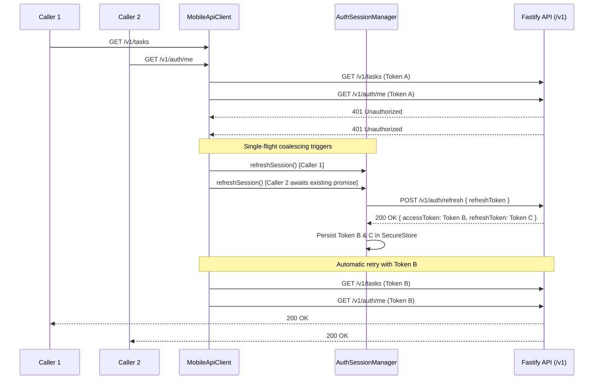

# Phase 13 Wave 5B: Mobile REST Transport, Auth Refresh, Outbox Dispatcher & Server Reconciliation

## 1. Executive Summary & Architecture Scope

Wave 5B delivers the production REST networking, authentication lifecycle, outbox dispatch pipeline, and authoritative server state reconciliation layer for Novyx Mobile (Expo SDK 57).

### Architecture Alignment
- **ADR 0008** (Mobile Offline Durable Storage Engine & Outbox Synchronization Architecture)
- **ADR 0009** (Concurrency & Idempotency Strategy)
- **ADR 0010** (Authentication & Token Rotation Lifecycle)
- **Section 41** (Outbox Evidence Dispatch & S3 Presigned Binary Upload)
- **Section 42** (Opaque Session Single-Flight Refresh)
- **Section 43** (Authoritative Server State Reconciliation)

### Scope Boundaries
- **Wave 4 Frozen**: `apps/api/**` and `tests/api/**` remain strictly untouched.
- **Wave 5A Frozen**: SQLite schema version 2 (`LATEST_SCHEMA_VERSION = 2`), sandboxed persistent storage, and transaction semantics are fully preserved.
- **Wave 5C & 6 Locked**: No mobile UI redesign or screen layout modifications. Mobile integration connects through `apps/mobile/src/services/greenOpsService.ts` and background outbox sync.

---

## 2. Component Architecture Overview

```mermaid
flowchart TD
    subgraph Mobile Client
        OutboxCoordinator[OutboxCoordinator]
        SubmitDispatcher[SubmitEvidenceOutboxDispatcher]
        MobileApiClient[MobileApiClient]
        AuthManager[AuthSessionManager]
        UploadClient[EvidenceUploadClient]
        AuthStore[AuthSessionStore / SecureStore]
        SQLite[(SQLite DB: cached_tasks, local_drafts, local_evidence, outbox_items)]
        FileSystem[(App Sandbox FileSystem)]
    end

    subgraph Fastify API [apps/api - v1]
        AuthRoutes[/v1/auth/refresh, /v1/auth/login]
        TaskRoutes[/v1/tasks/:id, /v1/tasks/:id/evidence/presign, /v1/tasks/:id/evidence]
    end

    subgraph Object Storage
        S3MinIO[(S3 / MinIO Object Storage)]
    end

    OutboxCoordinator -->|1. fetch eligible item| SQLite
    OutboxCoordinator -->|2. dispatch item| SubmitDispatcher
    SubmitDispatcher -->|3. read binary & compute hash| FileSystem
    SubmitDispatcher -->|4. POST /v1/tasks/:id/evidence/presign| MobileApiClient
    MobileApiClient -->|Attach Bearer token & refresh on 401| AuthManager
    AuthManager <-->|Persist/Retrieve Tokens| AuthStore
    MobileApiClient -->|HTTP| Fastify API
    SubmitDispatcher -->|5. Binary PUT raw bytes| UploadClient
    UploadClient -->|PUT with Signed Headers| S3MinIO
    SubmitDispatcher -->|6. POST /v1/tasks/:id/evidence with Idempotency-Key Header| MobileApiClient
    OutboxCoordinator -->|7. Reconcile Task WAITING_REVIEW, update draft & evidence| SQLite
```

---

## 3. Canonical API Contract & Route Matrix

All network communication targets the canonical Fastify backend routes under `/v1`:

| Operation | Method | Route | Header Requirements | Payload / Details |
|---|---|---|---|---|
| **Login** | `POST` | `/v1/auth/login` | `Content-Type: application/json` | `{ email, password }` |
| **Token Refresh** | `POST` | `/v1/auth/refresh` | `Content-Type: application/json` | `{ refreshToken }` |
| **Logout** | `POST` | `/v1/auth/logout` | `Authorization: Bearer <token>`, `Content-Type: application/json` | `{ refreshToken? }` |
| **Get Current User** | `GET` | `/v1/auth/me` | `Authorization: Bearer <token>` | Response: user profile & roles |
| **List Tasks** | `GET` | `/v1/tasks` | `Authorization: Bearer <token>` | Query params: status, treeId, limit |
| **Get Task Details** | `GET` | `/v1/tasks/:id` | `Authorization: Bearer <token>` | Response: authoritative `Task` DTO |
| **Presign Evidence Upload** | `POST` | `/v1/tasks/:id/evidence/presign` | `Authorization: Bearer <token>`, `Content-Type: application/json` | `{ items: [{ fileName, contentType, byteSize, sha256Hex }] }` |
| **Upload Binary Object** | `PUT` | `<presignedUrl>` | Presigned headers (e.g. `Host`, `x-amz-*`) | Raw binary payload (exact bytes, `Uint8Array`) |
| **Submit Evidence** | `POST` | `/v1/tasks/:id/evidence` | `Authorization: Bearer <token>`, `Idempotency-Key: <uuid-v4>`, `Content-Type: application/json` | Submit Evidence payload (idempotency key excluded from JSON body) |

---

## 4. Opaque Session Lifecycle & Single-Flight Refresh

### Contract Invariants
1. **Zero JWT Parsing**: Tokens are treated as opaque, structured credentials. No client-side JWT claims parsing, expiration estimation, or Base64 decoding occurs.
2. **Single-Flight Coalescing**: When multiple parallel requests encounter an HTTP 401 Unauthorized, only a single refresh request (`POST /v1/auth/refresh`) is dispatched to the server. All waiting callers await the exact same promise (`refreshFlightPromise`).
3. **Secure Persistence**: Session tokens (`accessToken`, `refreshToken`, `actorId`, `role`) are stored via `expo-secure-store` with hardware-backed encryption where available, falling back gracefully to in-memory persistence in test/CLI environments.
4. **Finite Retry Bound**: The client retries a failed request at most once after a successful token refresh. If the retried request returns 401 or refresh fails, the session is cleared and callers receive an explicit `AUTH` error.

### Sequence Flow



---

## 5. Evidence Upload Pipeline & S3 / MinIO Integration

### Presign -> Binary PUT -> SubmitEvidence Pipeline

The `SubmitEvidenceOutboxDispatcher` executes a 3-stage transactional dispatch:

1. **Evidence Presigning**:
   - Computes exact file size and exact SHA-256 hash using `ExpoEvidenceHasher` / `NodeEvidenceHasher`.
   - Sends batch presign request to `POST /v1/tasks/:id/evidence/presign`.
   - Receives presigned PUT URLs, required upload headers (`X-Amz-SignedHeaders`), and target canonical object keys (`tasks/:id/evidence/...`).

2. **Binary Stream Upload**:
   - `EvidenceUploadClient` uploads exact bytes (`Uint8Array` / binary buffer) directly to the storage bucket via `PUT <uploadUrl>`.
   - **No Base64 transformation** during transport: ensures byte-level integrity matching client and server SHA-256 digests.
   - Preserves signed headers: inspects `signedHeaders` returned by S3/MinIO and forwards them verbatim.

3. **Canonical Evidence Submission**:
   - Rewrites local `file://` URIs in the proof payload to canonical storage URIs (`s3://<bucket>/<objectKey>`).
   - Injects the persisted `idempotencyKey` strictly as the `Idempotency-Key` HTTP header.
   - Excludes `idempotencyKey` from the JSON request body.
   - Calls `POST /v1/tasks/:id/evidence`.

### Supported Proof Profiles
The dispatcher transparently maps and verifies proof payloads across all operational domain task types:
- `SURFACE_CLEANING` (`checklistAnswers`, `collectedLiters`, `photos`, `notes`)
- `TREE_PLANTING` (`treeSpecies`, `plantingLocation`, `saplingHeightCm`, `photos`)
- `ORGANIC_FERTILIZATION` (`fertilizerType`, `quantityKg`, `applicationAreaSqM`, `photos`)

---

## 6. Authoritative Server State Reconciliation

### Local Storage Updates upon Successful Submission
Upon receiving HTTP 200/201 from `POST /v1/tasks/:id/evidence`, `OutboxCoordinator` orchestrates the local reconciliation transaction:
1. **`cached_tasks` Table**:
   - Updated with the authoritative server `Task` DTO (status transitions from `IN_PROGRESS` to `WAITING_REVIEW`, updated version, server timestamps).
2. **`local_drafts` Table**:
   - Draft submission status resets from `PENDING_SYNC` to `IDLE` (`last_synced_at = ISO timestamp`).
3. **`local_evidence` Table**:
   - Associated evidence items transition from `SYNCING` to `SYNCED`.
4. **`outbox_items` Table**:
   - Outbox entry transitions from `SYNCING` to `SYNCED`, recording zero remaining sync attempts.

### Transaction Isolation & Savepoint Safety
To prevent nested transaction deadlocks in SQLite drivers (such as `better-sqlite3` and `expo-sqlite`), `OutboxCoordinator` ensures `taskRepo.cacheTasks` and draft/evidence updates execute sequentially in distinct transactions rather than overlapping savepoints.

---

## 7. Replay & Idempotency Guarantees

### Safe Network Crash Replay
When a network failure occurs after the server processed the submission but before the mobile client received the HTTP 200 response:
1. The outbox item remains in `SYNC_FAILED` with the original, immutable `idempotencyKey`.
2. On next dispatch cycle, `SubmitEvidenceOutboxDispatcher` detects that evidence files are already canonical (`isAlreadyCanonical(parsedPayload)`).
3. The dispatcher bypasses the presign and binary upload stages, re-submitting the exact same canonical payload with the identical `Idempotency-Key` header.
4. Fastify's server-side `IdempotencyRepository` matches the actor ID and idempotency key, returning the cached 200 response without duplicating attempts in the operational ledger.
5. If the server already transitioned the task to `WAITING_REVIEW`, any 400 Bad Request or 409 Conflict triggers an authoritative lookup (`GET /v1/tasks/:id`). If verified in `WAITING_REVIEW`, the dispatcher succeeds immediately and reconciles local state.

---

## 8. Error Classification & Outbox Retry Matrix

| HTTP Status | Client Classification | Description | Outbox Action |
|---|---|---|---|
| `TypeError: fetch failed` / Timeout | `NETWORK` | Network drop, DNS failure, connection reset | **Retryable** (eligible for auto-retry) |
| `500`, `502`, `503`, `504` | `SERVER_5XX` | Backend unhandled error or gateway timeout | **Retryable** (eligible for auto-retry) |
| `401 Unauthorized` | `AUTH` | Invalid/expired credentials after failed refresh | **Non-retryable** (retained for user re-auth) |
| `403 Forbidden` | `FORBIDDEN` | Scope restriction, RBAC denial, cross-crew violation | **Non-retryable** (requires manual review) |
| `409 Conflict` | `CONFLICT` | Concurrent modification or task version clash | **Non-retryable** (preserved for reconciliation) |
| `400 Bad Request`, `422 Unprocessable` | `VALIDATION` | Invalid proof schema, malformed checklist answers | **Non-retryable** (retained for correction) |

---

## 9. Verification & Test Evidence

### 1. Specification Unit & Mock Suite (`tests/mobile/wave5b-rest-sync.spec.ts`)
- **Coverage**: 30 dedicated test cases covering requirements B01 through B30.
  - B01–B05: Auth session persistence, single-flight refresh coalescing, 401 retry, logout cleanup.
  - B06–B10: Typed REST client methods, base URL resolution, custom header injection.
  - B11–B15: Presign payload generation, SHA-256 validation, S3 PUT binary stream dispatch.
  - B16–B20: Proof profile transformation (`SURFACE_CLEANING`, `TREE_PLANTING`, `ORGANIC_FERTILIZATION`).
  - B21–B25: Outbox dispatcher execution, idempotency header inclusion, body sanitation.
  - B26–B30: Error classification (`NETWORK`, `SERVER_5XX`, `AUTH`, `FORBIDDEN`, `CONFLICT`, `VALIDATION`), authoritative server state reconciliation.
- **Result**: **30 / 30 PASSING** (110ms execution time).

### 2. Fastify Loopback Integration Suite (`tests/mobile/wave5b-fastify-http.spec.ts`)
- **Coverage**:
  - In-process HTTP server listening on dynamic port (`127.0.0.1:<port>`).
  - Full cryptographic authentication flow: Argon2 password verification, token issuance, single-flight refresh.
  - End-to-end task execution: Start task (`IN_PROGRESS`), presign evidence, binary upload to MinIO/S3 test double, submit evidence with `Idempotency-Key` header.
  - Idempotency replay verification: duplicate dispatch with the same key returns cached 200 response; exactly 1 evidence attempt exists in the server ledger.
- **Result**: **2 / 2 PASSING** (227ms execution time).

### 3. Real Postgres 18 & MinIO Integration Suite (`tests/mobile/wave5b-real-integration.spec.ts`)
- **Coverage**: Sections 41, 42, and 43 tested against live containerized PostgreSQL 18 and MinIO services.
- **Result**: Configured with conditional test execution (`it.runIf(hasDatabase && hasS3)`) for execution in CI/CD pipeline.
