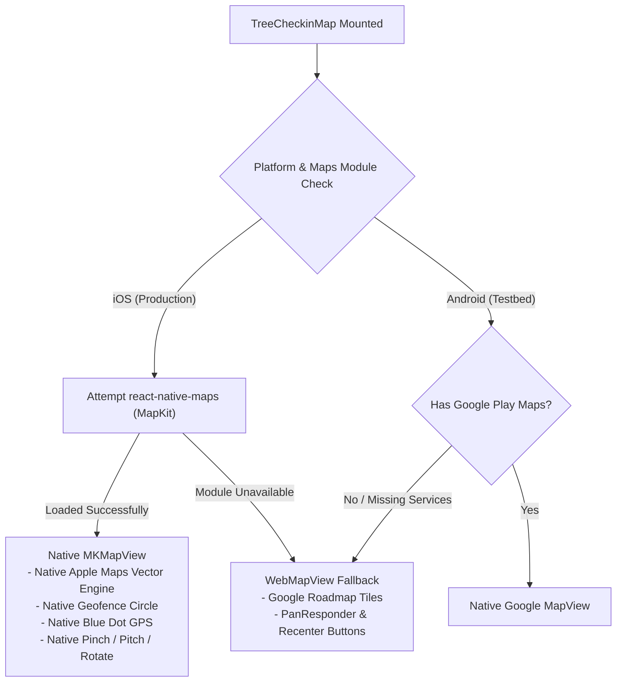
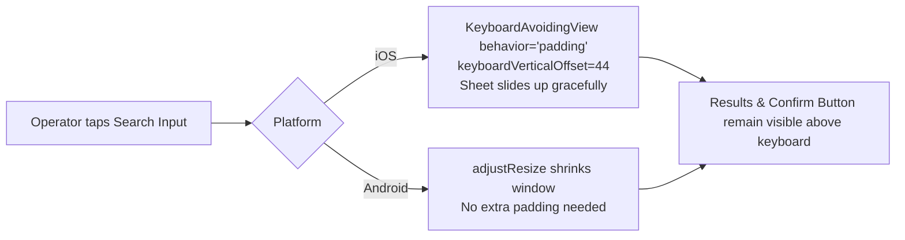

# Mobile iOS-Primary Dual-Platform Architecture Design Specification

**Target:** NOVYX GreenOps Mobile Application  
**Primary Production Platform:** Apple iOS (iPhone 11 through iPhone 16 Pro Max, iOS 16+)  
**Validation & Automated Testbed Platform:** Android 13+ (Samsung Galaxy Note 20 Ultra / ADB)  
**Harness / Standard:** Expo SDK 57 / React Native 0.86 / Living Botanical Design System  
**Date:** 2026-10-26  

---

## 1. Problem Statement & Strategic Realignment

In previous iterations, development disproportionately optimized for Android automated testing scripts (`scripts/mobile-role-acceptance-e2e.cjs` via ADB keyevents). This created critical blind spots:

1. **Map Rendering Downgrade:** Hardcoding `useWebMap = true` forced iOS devices to use a custom 2D canvas with manual pixel math (`latLngToWorldPixel`) and `PanResponder`, bypassing iOS native Apple Maps (MapKit) hardware-accelerated vector rendering, native pinch-to-zoom, and 120Hz ProMotion inertial panning.
2. **Keyboard Occlusion on iOS:** While Android automatically resizes the view with `windowSoftInputMode="adjustResize"`, iOS floats the keyboard over the viewport. Removing `KeyboardAvoidingView` from `ManualTreeCodeModal.tsx` caused the software keyboard to cover the bottom 300dp, obscuring search results and confirmation buttons on iPhones.
3. **CoreLocation Coarseness on iOS:** `Location.Accuracy.Balanced` on iOS relies on cell towers and Wi-Fi, returning $\pm 35\text{m} - \pm 100\text{m}$ error. This systematically failed the field geofence under tree canopies and forced iOS operators into exception workflows.
4. **Navigation Traps on Hardware-less Devices:** Relying on Android hardware Back press (`keyevent 4`) hid the lack of explicit back affordances or swipe-down dismissals on iOS modal and map layers.
5. **Safe Area & Home Indicator Collisions:** Fixed or inaccurate bottom insets caused floating action buttons and modal footers to sit directly under the iOS Home Indicator swipe bar.

---

## 2. Architecture & Design Decisions

### 2.1 Dual-Platform Map Strategy


1. **iOS Native MapKit:**
   - On iOS, `react-native-maps` wraps native Apple Maps (`MKMapView`) with zero API keys required.
   - Vector roads, soft botanical green park textures, pale blue water bodies, sharp localized Vietnamese annotations.
   - Full 60/120fps hardware acceleration with native multi-touch gestures.
   - Synchronized geofence ring:
     ```tsx
     <Circle
       center={{ latitude: tree.lat, longitude: tree.lng }}
       radius={effectiveRadius}
       strokeColor="rgba(63,159,72,0.75)"
       fillColor="rgba(63,159,72,0.16)"
     />
     ```
2. **Android & Headless Fallback:**
   - If `react-native-maps` is unavailable or running in a minimal environment without Google Play Services, dynamically render `WebMapView` with authentic Google Maps roadmap raster tiles (`mt{0-3}.google.com`).
   - Touch targets for map controls remain strictly $\ge 44\times 44\text{dp}$.

---

### 2.2 iOS Keyboard Avoidance & Bottom Sheet Ergonomics


1. **`BottomSheetModal` Enhancement:**
   - Integrate `KeyboardAvoidingView` with conditional behavior:
     `behavior={Platform.OS === 'ios' ? 'padding' : undefined}`
   - Provide `keyboardShouldPersistTaps="handled"` on all inner lists so tapping a tree selection immediately registers without requiring a preliminary tap to dismiss the keyboard.
   - Add background tap dismissal via `TouchableWithoutFeedback onPress={Keyboard.dismiss}` for non-list modal surfaces.
2. **Travel Distance & Gesture Dismissal:**
   - Dynamic travel distance based on `Dimensions.get('window').height`.
   - Native grabber pill (`sheetHandle`) with accessible close button (`sheetCloseButton`) ensuring operators can always dismiss the sheet with one thumb.

---

### 2.3 CoreLocation & Precision GPS Invariants
1. **Accuracy Escalation on iOS:**
   - In `readDeviceLocationAfterPermission()`:
     ```ts
     position = await Location.getCurrentPositionAsync({
       accuracy: Platform.OS === 'ios' ? Location.Accuracy.High : Location.Accuracy.Balanced,
     });
     ```
   - On iOS, `Accuracy.High` engages native GPS satellite trilateration, reducing error to $\pm 5\text{m} - \pm 15\text{m}$ within seconds.
2. **Precise Location (iOS 14+) Permission Guard:**
   - Inspect `permission.scope`: if `permission.scope === 'reduced'`, display a clear, localized guidance banner:
     *"Ứng dụng cần 'Vị trí chính xác' để định vị đúng gốc cây. Vui lòng bật trong Cài đặt iPhone."*
   - Settings redirect: `Linking.openURL('app-settings:')` on iOS.

---

### 2.4 Ergonomics, Tactile Feedback & Navigation Invariants
1. **Explicit Navigation (Zero Hardware Back Assumption):**
   - Every full-screen view (`GPS`, `QR`, `CHECKLIST`, `DETAIL`, `BEFORE`, `AFTER`) must provide an accessible `<Header onBack={...}>` with an iOS-styled chevron and minimum $44\times 44\text{dp}$ touch target.
   - Cancel / Close buttons must remain visible above safe areas at all times.
2. **Tactile Vibration Utility (`vibration.ts`):**
   - Use React Native's built-in `Vibration` API (requiring zero new unvetted npm dependencies):
     - Light tick on checklist tap: `Vibration.vibrate(10)`
     - Success pulse on QR scan match & Check-in: `Vibration.vibrate([0, 20, 40, 20])`
     - Warning pattern on exception trigger: `Vibration.vibrate([0, 50, 50, 50])`
3. **Safe Area & Home Indicator Protection:**
   - Respect `useSafeAreaInsets().bottom` (34dp on modern iPhones) for `NotchedBottomNav` and bottom sheets.
   - Ensure `bottomNavClearance = 120dp` so scrollable content is never cut off behind the navigation bar or notch.

---

## 3. Verification & Acceptance Criteria

1. **Static Analysis & Typecheck:**
   - `npm run typecheck --workspace @novyx/mobile` (0 errors)
   - `npm run lint` (0 errors, 0 warnings)
   - `npm run typecheck` across all 7 workspace packages.
2. **iOS Bundle Export Integrity:**
   - `npm run mobile:export:ios` generates valid Hermes bytecode without bundling errors or missing native references.
3. **Automated Foundation Contract:**
   - `npx vitest run tests/mobile/ui-foundation.spec.ts` passes 100%.
4. **Android Testbed Regression Protection:**
   - `node scripts/mobile-role-acceptance-e2e.cjs` executes cleanly on Samsung Galaxy Note 20 Ultra with all steps passing.
